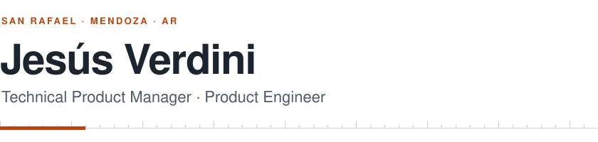

<picture>
  <source media="(prefers-color-scheme: dark)" srcset="assets/header-dark.svg">
  
</picture>

I turn business needs into systems people use every day. I'm a Computer Engineer working for a group of companies in Mendoza, Argentina (internet, agribusiness, signage), where I build from scratch the tools each team needs: I sit down with whoever has the problem, write the spec, build it and stay with it until it's part of their routine.

### What I've built

| The problem | What I did |
|:---|:---|
| The field operations team planned in Excel which technicians and vehicles went out on each schedule. | A scheduling engine that calculates each day's capacity. It's now part of their daily routine. |
| The call center couldn't see calls waiting in queue in real time. | A dashboard with their KPIs and a wallboard for the room's screens that refreshes every second. |
| The fleet needed to know where each vehicle stops and why. | GPS monitoring. Checking it against the official source showed that on some days almost a third of the kilometers were being lost, so I tuned the algorithm until the numbers matched. |
| Management wanted to plan and track every project in the group in one place. | A board-based platform where each project asks for more data as it moves forward, with an MCP server that lets AI agents operate it with the user's own permissions, without bypassing business rules. |

### How I work

No request reaches the code without discovery, technical validation and a spec. With the team we defined a 12-stage process for that, with document templates and checkpoints.

I use AI agents across the whole cycle: to capture meetings, write specs, code, review changes before every production release and document decisions. Anything with an external effect (an email, a deploy, a database write) goes through my review first.

In the code: strict TypeScript, layered architecture, tests against a real database, ADRs for the decisions that matter, and Conventional Commits with CI.

### Stack

**Backend** &nbsp; `Node.js` `TypeScript` `Express` `Python`  
**Frontend** &nbsp; `React` `Vite`  
**Data** &nbsp; `PostgreSQL` `Drizzle ORM` `SQL`  
**AI** &nbsp; `Claude` `OpenAI` `MCP` `n8n`  
**Infra** &nbsp; `Docker` `GitHub Actions` `Linux`

### About these repos

My work code is private to the company. What's public here are university projects from when I was learning.

---

[LinkedIn](https://www.linkedin.com/in/jesusverdini/) · [verdini.jesus@gmail.com](mailto:verdini.jesus@gmail.com)
